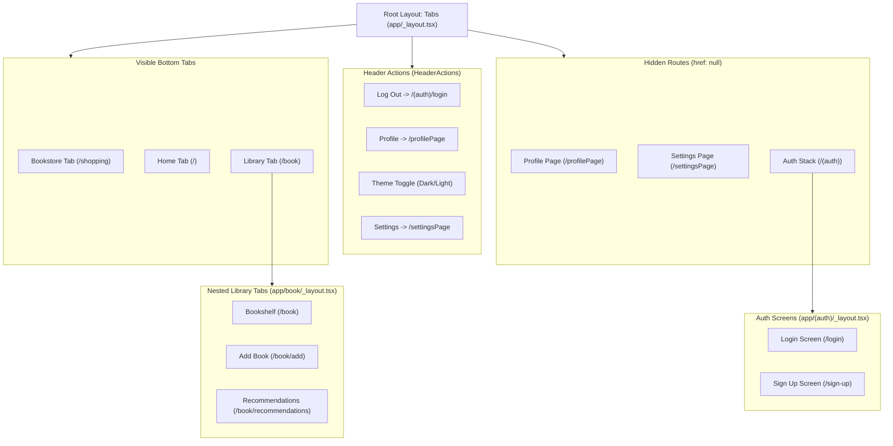
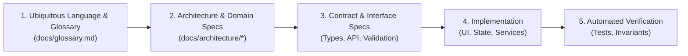

# Current State Assessment — Soft-Touch

*Last Updated: November 2026*  
*Repository: `soft-touch`*  
*Framework & Core: Expo ~54.0.29 | React Native 0.81.5 | React 19.1.0 | NativeWind v4.2.1 | React Native Reusables*

---

## 1. Executive Summary

**Soft-Touch** is a cross-platform (iOS, Android, Web) mobile application initialized via the `@react-native-reusables/cli` template. It is designed as a digital personal library manager and companion bookstore for readers.

The application combines:
- **Reader Identity & Profile Management** (Authentication, profile overview, preferences)
- **Personal Library & Bookshelf** (Tracking books, reading list, adding books, discovery/recommendations)
- **Bookstore / Commerce Flow** (Browsing and purchasing books)
- **Modern Design System** based on Tailwind CSS / NativeWind and shadcn/ui-inspired primitives (`@rn-primitives`)

The codebase is in an early prototype / scaffolding stage. Core navigation skeletons and sample UI screens exist, but business logic, backend APIs, persistent storage, form validation, and test coverage have not yet been implemented.

---

## 2. Technology Stack & Tooling

| Layer | Technology | Version | Purpose / Notes |
| :--- | :--- | :--- | :--- |
| **Runtime & Platform** | [Expo SDK](https://expo.dev/) | `~54.0.29` | New Architecture enabled (`newArchEnabled: true`), Edge-to-Edge Android |
| **Core Framework** | [React Native](https://reactnative.dev/) | `0.81.5` | React `19.1.0` (with `react-dom` 19.1.0) |
| **Routing** | [Expo Router](https://docs.expo.dev/router/introduction/) | `~6.0.19` | File-based routing with typed routes (`experiments.typedRoutes: true`) |
| **Navigation Primitives** | `@react-navigation/native` | `^7.0.0` | Powers underlying navigators and theme container |
| **Styling** | [NativeWind](https://www.nativewind.dev/) | `^4.2.1` | Tailwind CSS v3 compiler for React Native (`tailwindcss: ^3.4.14`) |
| **Component Primitives**| [React Native Reusables](https://reactnativereusables.com) | Latest | `@rn-primitives/*` (label, portal, separator, slot) |
| **Styling Utilities** | `class-variance-authority`, `tailwind-merge`, `clsx` | `0.7.1`, `3.3.1`, `2.1.1` | Variant styling (`cva`) & class merging (`cn`) |
| **Iconography** | `lucide-react-native`, `lucide-react` | `^0.545.0`, `^1.3.0` | NativeWind `cssInterop` icon wrapper |
| **Date Handling** | `date-fns`, `@react-native-community/datetimepicker`, `react-day-picker` | `^4.1.0`, `^8.4.4`, `^9.14.0` | Cross-platform date picker support |
| **Web Primitives** | `@radix-ui/react-popover`, `@radix-ui/react-slot`, `react-native-web` | `^1.1.15`, `^1.2.4`, `^0.21.0` | Web fallback & Radix primitive integrations |
| **Animation & Gestures** | `react-native-reanimated`, `react-native-screens`, `react-native-safe-area-context` | `~4.1.1`, `~4.16.0`, `~5.6.0` | Standard Expo New Architecture layout stack |
| **Code Formatting** | `prettier`, `prettier-plugin-tailwindcss` | `^3.6.2`, `^0.6.14` | Automatic Tailwind class sorting with 100 print width |

---

## 3. Repository File Structure

```
soft-touch/
├── .idea/                      # JetBrains project metadata
├── ai/                         # Agent & specification operational rules
│   ├── current-state.md        # Comprehensive repository state (this file)
│   └── rule.md                 # Agent governance rule (Developer-only manual commits)
├── app/                        # Expo Router file-based application routes
│   ├── (auth)/                 # Authentication route group (hidden from main tab bar)
│   │   ├── _layout.tsx         # Stack navigator for authentication
│   │   ├── login.tsx           # Login screen (/login)
│   │   └── sign-up.tsx         # User registration screen (/sign-up)
│   ├── book/                   # Library / Bookshelf feature area
│   │   ├── _layout.tsx         # Nested bottom tab navigator (Bookshelf, Add, Recommendations)
│   │   ├── add.tsx             # Add new book screen
│   │   ├── index.tsx           # Library bookshelf overview (sample catalog list)
│   │   └── recommendations.tsx # Book recommendations tab
│   ├── shopping/               # Bookstore / Commerce feature area
│   │   ├── _layout.tsx         # Tab layout scaffold for bookstore
│   │   └── index.tsx           # Bookstore landing / purchase screen
│   ├── +html.tsx               # Web HTML entry template
│   ├── _layout.tsx             # Root layout: ThemeProvider, PortalHost, Root Tabs
│   ├── index.tsx               # Home screen (welcome view)
│   ├── profilePage.tsx         # User profile screen (tab hidden, accessed from header)
│   └── settingsPage.tsx        # Settings screen (tab hidden, accessed from header)
├── assets/images/              # Icons, adaptive icons, splash screen assets
├── components/                 # Reusable UI & Feature components
│   ├── ui/                     # Primitives styled with NativeWind / CVA
│   │   ├── button.tsx          # Button variants (default, secondary, destructive, outline, ghost, link)
│   │   ├── calendar.tsx        # Calendar component (react-day-picker / Radix Web)
│   │   ├── card.tsx            # Card, CardHeader, CardTitle, CardDescription, CardContent, CardFooter
│   │   ├── icon.tsx            # Lucide icon wrapper with NativeWind className styling
│   │   ├── input.tsx           # TextInput wrapper with dark mode & accessibility styles
│   │   ├── label.tsx           # Accessible form label built on @rn-primitives/label
│   │   ├── popover.tsx         # Popover component built on @radix-ui/react-popover
│   │   ├── separator.tsx       # Visual divider built on @rn-primitives/separator
│   │   └── text.tsx            # Custom Text supporting variants (h1-h4, p, muted, lead, code)
│   ├── book-card.tsx           # Book summary presentation card with cover image support and onEdit action
│   ├── datepicker.tsx          # Cross-platform date picker demo (date-fns + DateTimePicker)
│   ├── edit-book-modal.tsx     # Book details & cover location editor modal
│   ├── sign-in-form.tsx        # Email & password login form with social connection links
│   ├── sign-up-form.tsx        # Registration form (first name, last name, datepicker, email, password)
│   └── social-connections.tsx  # OAuth provider action buttons (Apple, Google, GitHub)
├── docs/                       # Project documentation & Spec-Driven Development specs
│   ├── architecture/           # Architecture diagrams & technical decision records (TDRs)
│   └── glossary.md             # Ubiquitous domain language & terminology mappings
├── lib/                        # Shared utility code & configuration
│   ├── book-store.ts           # Reactive in-memory book store (useSyncExternalStore)
│   ├── theme.ts                # Light / Dark theme tokens & React Navigation theme bridge
│   └── utils.ts                # Class name concatenator (clsx + tailwind-merge)
├── .gitignore                  # Git ignore definitions
├── .prettierrc                 # Prettier configuration
├── app.json                    # Expo project configuration
├── babel.config.js             # Babel compiler config with NativeWind preset
├── CLAUDE.md                   # Assistant workspace guide
├── components.json             # Shadcn / React Native Reusables registry metadata
├── global.css                  # CSS Variables & Tailwind root theme rules
├── metro.config.js             # Metro bundler with NativeWind wrapper
├── nativewind-env.d.ts         # TypeScript ambient definitions for NativeWind
├── package.json                # NPM dependencies and run scripts
├── README.md                   # Project onboarding instructions
├── tailwind.config.js          # Tailwind CSS theme extension & design tokens
└── tsconfig.json               # TypeScript path aliases (@/*) and compiler options
```

---

## 4. Navigation & Routing Architecture

The navigation architecture is organized using Expo Router's file-based system:



### Route Summary Table

| Route Path | Physical File | Navigation Role | Current Status |
| :--- | :--- | :--- | :--- |
| `/` | `app/index.tsx` | Main Home Screen (Tab: "Home") | Basic welcome header banner |
| `/shopping` | `app/shopping/index.tsx` | Bookstore Screen (Tab: "Bookstore") | Stub text ("You can buy your books here") |
| `/shopping/*` | `app/shopping/_layout.tsx` | Bookstore sub-tabs | Duplicate scaffold copy of book tabs |
| `/book` | `app/book/index.tsx` | Personal Library (Subtab: "Bookshelf") | Reactive list connected to `lib/book-store.ts` with inline Book details/cover editing modal |
| `/book/add` | `app/book/add.tsx` | Add Book (Subtab: "Add Book") | Interactive form simulation with in-memory image picker (Data URL / presets), in-memory store dispatch, and preview |
| `/book/recommendations` | `app/book/recommendations.tsx` | Recommendations (Subtab: "Recommendations") | Stub placeholder screen |
| `/profilePage` | `app/profilePage.tsx` | User Profile (Header shortcut) | Stub text ("Welcome to your Profile") |
| `/settingsPage` | `app/settingsPage.tsx` | Application Settings (Header shortcut) | Stub text ("Welcome to your settings") |
| `/(auth)/login` | `app/(auth)/login.tsx` | User Sign In | Complete form layout with mock submit |
| `/(auth)/sign-up` | `app/(auth)/sign-up.tsx` | User Registration | Complete form layout with birthdate picker |

---

## 5. Domain Models & Data Structures

Currently, data structures are limited to local TypeScript definitions without database or API bindings:

### 1. `Book` Model (`components/book-card.tsx`)
```typescript
export type Book = {
  title: string;        // Full title of the volume
  author: string;       // Primary author / creator
  isbn: string;         // International Standard Book Number
  coverUri?: string;    // Optional remote URI for cover art
  description?: string; // Optional narrative summary
};
```
*Current sample records:*
- *Kafka, Franz*: *Der Prozess* (ISBN `978-3-15-009676-7`, OpenLibrary cover image)
- *Goethe, Johann Wolfgang von*: *Faust I* (ISBN `978-3-15-000001-3`, without cover)

### 2. User & Authentication Models
No formal TypeScript interface is defined yet for users. The registration form collects:
- `vorname` (First Name)
- `nachname` (Last Name)
- `geburtsdatum` (Date of Birth - via `date-fns` & `@react-native-community/datetimepicker`)
- `email` (User email address)
- `password` (User password)
- `password_confirm` (Password verification field)

### 3. Social Connection Strategies (`components/social-connections.tsx`)
Hardcoded array defining third-party OAuth sign-in targets:
- `oauth_apple`
- `oauth_google`
- `oauth_github`

---

## 6. Theming & Styling Architecture

The application adopts the **shadcn/ui** pattern adapted for React Native via NativeWind:

1. **Theme Tokens (`lib/theme.ts`)**:
   - `THEME.light` & `THEME.dark`: HSL color values matching Tailwind design tokens (background, foreground, card, popover, primary, secondary, muted, accent, destructive, border, input, ring, charts 1-5).
   - `NAV_THEME`: Bridges theme tokens directly to React Navigation's `Theme` interface (`DefaultTheme` and `DarkTheme`).

2. **CSS Variables (`global.css`)**:
   - Defines CSS root variables (`:root` and `.dark:root`) matching the HSL values from `theme.ts`.

3. **Tailwind Config (`tailwind.config.js`)**:
   - Maps Tailwind color utilities (`bg-background`, `text-primary`, `border-border`, etc.) to `hsl(var(--...))` CSS variables.

4. **Dynamic Scheme Switching**:
   - `useColorScheme()` from `nativewind` handles switching between dark and light modes.
   - Header action button in `app/_layout.tsx` calls `toggleColorScheme()` on press.

---

## 7. Audit of Technical Debt, Inconsistencies & Issues

During the codebase inspection, several specific issues and technical debts were identified:

1. **Mixed Icon Package Imports**:
   - In `app/_layout.tsx`: `LogOut`, `MoonStarIcon`, `SunIcon`, `User` are imported from `lucide-react-native`, while `Cog`, `House`, `SquareLibrary`, `Store` are imported from `lucide-react` (the React DOM web library).
   - *Impact*: In native builds (iOS/Android), web-only SVG components from `lucide-react` can trigger runtime rendering errors. All mobile icon usage should consistently use `lucide-react-native` wrapped with `components/ui/icon.tsx`.

2. **Duplicated / Invalid Nested Layout in `app/shopping/_layout.tsx`**:
   - `app/shopping/_layout.tsx` declares three tabs (`index`, `add`, `recommendations`), but the `app/shopping/` folder only contains `index.tsx`. The titles and icons are copy-pasted directly from `app/book/_layout.tsx`.
   - *Impact*: Clicking the phantom tabs causes missing route warnings or broken navigation.

3. **Web DOM Primitives in Native Components**:
   - `components/ui/calendar.tsx` renders raw HTML elements (`<div data-slot="calendar">`, `<td>`).
   - `components/ui/popover.tsx` imports directly from `@radix-ui/react-popover`.
   - *Impact*: These components fail when rendered on iOS or Android unless run in a web environment. The project needs proper platform separation or React Native primitive implementations for mobile calendar and popover.

4. **Mixed Language Terminology in UI & Code**:
   - UI strings mix English and German without localization:
     - English: *"Create your account"*, *"Welcome back"*, *"Add Book"*, *"Recommendations"*, *"You can buy your books here"*.
     - German: *"Ihre Bücher"*, *"Hier können Sie ein neues Buch hinzufügen"*, *"Vorname"*, *"Nachname"*, *"Geburtsdatum"*, *"Password verifizieren"*.
   - *Impact*: Inconsistent user experience and lack of internationalization (`i18n`).

5. **No Persistent State or Data Management**:
   - No SQLite / Expo SQLite, WatermelonDB, AsyncStorage, Zustand, or TanStack Query configured.
   - Form inputs (`SignInForm`, `SignUpForm`) are uncontrolled or have empty `onSubmit` stubs.

6. **Missing Testing & Quality Assurance Infrastructure**:
   - No Jest, React Native Testing Library, or Maestro/E2E test setup.
   - No ESLint configuration or script (`npm test` and `npm run lint` are absent from `package.json`).

7. **Rule Compliance**:
   - `ai/rule.md` specifies: *"Do not make any commit. Commits will be done by developer manually."*
   - All tasks must strictly adhere to not executing `git commit`.

---

## 8. Spec-Driven Development (SDD) Roadmap

To transition this codebase into a robust, scalable system under Spec-Driven Development:



1. **Step 1: Domain Glossary** (Completed in `docs/glossary.md`)
   - Unify English/German nomenclature and define core concepts across Reader, Library, Bookstore, and Identity.
2. **Step 2: Architecture Specifications**
   - Document cross-platform strategy (Web vs Mobile primitives).
   - Document navigation hierarchy and state boundaries.
3. **Step 3: Feature Specifications**
   - **Auth Spec**: Registration, Login, OAuth, Session lifecycle.
   - **Library Spec**: Bookshelf list, Book detail, Add book (ISBN barcode scan or manual entry), Recommendations engine.
   - **Bookstore Spec**: Catalog search, Book preview, Cart, Checkout.
4. **Step 4: Quality & Verification**
   - Install testing harness (`jest`, `@testing-library/react-native`).
   - Verify every requirement against written acceptance criteria before implementation.

