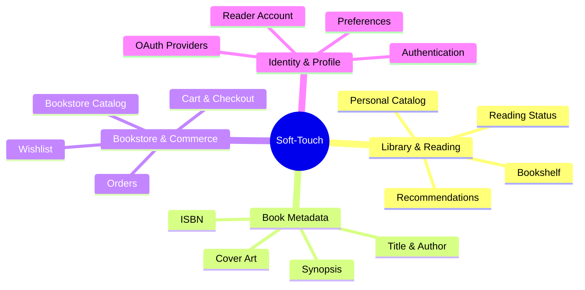

# Domain Glossary & Ubiquitous Language — Soft-Touch

*Document: `docs/glossary.md`*  
*Approach: Spec-Driven Development (SDD) / Domain-Driven Design (DDD)*  
*Purpose: Establish single, unambiguous terminology for all business logic, specifications, database schemas, API contracts, and UI components.*

---

## 1. Domain Overview

The **Soft-Touch** system is a digital companion for avid readers, structured across four core subdomains:

---

## 2. Core Subdomain Glossaries

### 2.1 Reader & Personal Library Subdomain

Concepts relating to the reader's personal collection, reading habits, and curation:

| Canonical Term | German Source Term | Definition | Rules & Constraints |
| :--- | :--- | :--- | :--- |
| **Personal Library** | *Persönliche Bibliothek* | The aggregate collection of all books owned, saved, or tracked by an individual reader. | Scoped to a specific authenticated user account. |
| **Bookshelf** | *Bücherregal* | A curated view or collection within the Personal Library (e.g., "Currently Reading", "Favorites", or custom shelf). | Default shelf contains all tracked volumes. |
| **Book Series / Group** | *Buchreihe / Buchgruppe* | Automatic clustering of volumes sharing a base title, volume numbers, or subtitles (e.g. "Buch der Träume 1 & 2", "Faust I & II"). | Formed dynamically when 2+ books share a normalized title stem. Supports collapsible section views on the Bookshelf. |
| **Book Item / Entry** | *Bucheintrag* | A record representing a specific volume added to a reader's Personal Library. | References bibliographic metadata plus reader-specific state (date added, notes, rating). |
| **Reading Status** | *Lesestatus* | The current progression state of a book in the reader's lifecycle. | Standard states: `WANT_TO_READ`, `READING`, `COMPLETED`, `ON_HOLD`, `DROPPED`. |
| **Reading Progress** | *Lesefortschritt* | Metric measuring how far the reader has progressed through a volume. | Expressed in page count (`currentPage / totalPages`) or percentage (`0 - 100%`). |
| **Recommendation** | *Buchempfehlung* | A suggested book presented to the user based on preferences, genre affinity, or reading history. | Rendered in the Recommendations view (`/book/recommendations`). |
| **Book Rating** | *Buchbewertung* | Reader evaluation score assigned to a completed or read book. | Typically 1 to 5 stars or numerical score. |
| **Personal Note** | *Notiz / Annotation* | Private markdown or plain-text reflections recorded by the reader for an entry. | Visible only to the owner of the library. |

---

### 2.2 Book Catalog & Bibliographic Metadata Subdomain

Concepts defining universal, edition-specific book publication data:

| Canonical Term | German Source Term | Definition | Rules & Constraints |
| :--- | :--- | :--- | :--- |
| **Book** | *Buch* | The conceptual intellectual or literary work. | Independent of specific physical or digital binding. |
| **Edition / Volume** | *Ausgabe / Band* | A specific published manifestation of a work. | Identified by unique ISBN and publication year. |
| **ISBN** | *ISBN* | International Standard Book Number. Unique international commercial identifier for published books. | Supports ISBN-10 (e.g., `3-15-009676-X`) or ISBN-13 (e.g., `978-3-15-009676-7`). Must validate check digits. |
| **Title** | *Buchtitel* | The primary official name of the publication. | Mandatory field; non-empty string. |
| **Author** | *Autor / Urheber* | The primary creator, writer, or editor responsible for the work. | One or more contributors associated with a volume. |
| **Cover Art / Cover URI** | *Buchcover / Einband* | Visual image asset of the book's front cover. | Remote HTTPS URI (e.g., OpenLibrary, publisher CDN) or local fallback graphic (`No cover`). |
| **Synopsis / Description** | *Beschreibung / Klappentext* | Short narrative overview or blurb detailing the book's premise. | Optional; truncated in summary cards with full disclosure on detail views. |
| **Publisher** | *Verlag* | The commercial company or entity that published the volume. | Optional bibliographic field. |
| **Publication Date** | *Erscheinungsdatum* | The calendar date or year the edition was released. | ISO-8601 formatted date string (`YYYY-MM-DD` or `YYYY`). |
| **Page Count** | *Seitenzahl* | The total number of pages in the printed edition. | Positive integer (`> 0`). |
| **Genre / Category** | *Genre / Sachgebiet* | Standardized literary or non-fiction classification (e.g., Fantasy, Klassiker, Drama, Philosophie, etc.). | Multi-select string array (`genres?: string[]`). Used for top-level bookshelf categorization. |

---

### 2.3 Bookstore & Commerce Subdomain

Concepts governing the commercial exploration and purchase of books:

| Canonical Term | German Source Term | Definition | Rules & Constraints |
| :--- | :--- | :--- | :--- |
| **Bookstore** | *Buchhandlung / Shop* | The commercial browsing surface of the app (`/shopping`). | Allows readers to discover, inspect, and purchase books. |
| **Catalog Listing** | *Katalogangebot* | A commercial item available for purchase from vendor inventory. | Linked to a Book record with pricing and stock data. |
| **Price** | *Preis* | The financial cost required to purchase a book. | Decimal amount paired with currency code (e.g., `€14.99`, `EUR`). |
| **Stock / Availability** | *Verfügbarkeit* | Inventory status of a book item. | `IN_STOCK`, `LOW_STOCK`, `OUT_OF_STOCK`, `PREORDER`. |
| **Wishlist** | *Wunschliste / Merkliste* | A list of commercial books marked by the reader for future acquisition. | Distinct from the Personal Library; represents interest before acquisition. |
| **Shopping Cart** | *Warenkorb* | Temporary collection of book listings selected for purchase. | Persisted per user session. |
| **Order** | *Bestellung* | A finalized commercial transaction containing one or more books. | Assigned unique Order ID, status, and timestamp. |

---

### 2.4 User Identity, Authentication & Profile Subdomain

Concepts governing account creation, credentials, security, and preferences:

| Canonical Term | German Source Term | Definition | Rules & Constraints |
| :--- | :--- | :--- | :--- |
| **Reader / User** | *Leser / Benutzer* | The registered individual using the Soft-Touch application. | Identified by unique `userId` and verified email. |
| **First Name** | *Vorname* | The given legal or preferred name of the user. | Displayed in profile greeting and account information. |
| **Last Name** | *Nachname* | The family name or surname of the user. | Stored in reader profile. |
| **Date of Birth** | *Geburtsdatum* | Calendar date of user's birth, entered via date picker. | Used for age verification or reading age categorization; cannot be in the future. |
| **Email Address** | *E-Mail-Adresse* | Unique digital address for authentication and communication. | Validated standard email pattern (e.g., `user@domain.com`). |
| **Password** | *Passwort* | Secret credential string used for password-based authentication. | Must meet security requirements (minimum length, complexity). |
| **Password Confirmation** | *Passwort-Bestätigung* | Duplicate entry of password during registration to prevent typos. | Must strictly equal `Password`. |
| **Social Connection (OAuth)** | *Soziale Authentifizierung* | Third-party identity delegation (Apple, Google, GitHub). | Authenticated via OAuth 2.0 / OIDC provider token. |
| **Session** | *Benutzersitzung* | Active authenticated window maintaining user state. | Managed via secure storage token with refresh lifecycle. |
| **Color Theme** | *Farbmodus* | Visual display mode preference of the application. | `light`, `dark`, or `system` (automatic). |

---

### 2.5 User Interface & Navigation Hierarchy Subdomain

Concepts related to the user journey and navigation structures in Expo Router:

| Canonical Term | Route / Symbol | Definition |
| :--- | :--- | :--- |
| **Root Tab Navigator** | `app/_layout.tsx` | Primary persistent navigation bar at the bottom of the viewport containing main areas: Bookstore, Home, Library. |
| **Home Tab** | `/` (`app/index.tsx`) | Main entrance screen displaying greeting, dashboard highlights, and recent reading activity. |
| **Bookstore Tab** | `/shopping` (`app/shopping/`) | E-commerce storefront tab for browsing and purchasing books. |
| **Library Tab** | `/book` (`app/book/`) | Personal library section containing nested tabs for bookshelf management. |
| **Nested Library Tabs** | `app/book/_layout.tsx` | Secondary sub-tab bar inside the Library area: **Bookshelf**, **Add Book**, **Recommendations**. |
| **Header Actions** | `HeaderActions` | Persistent top-right navigation bar containing quick access triggers: **Log Out**, **Profile**, **Theme Toggle**, **Settings**. |
| **Auth Group** | `app/(auth)/` | Stack route group containing unauthenticated onboarding screens: `/login` and `/sign-up`. Hidden from root tabs. |
| **Profile Page** | `/profilePage` | Dedicated screen for managing reader profile details, bio, and account info. |
| **Settings Page** | `/settingsPage` | Dedicated screen for application preferences, notifications, theme, and language. |
| **Book Card** | `<BookCard />` | Reusable presentation card displaying book cover, title, author, description preview, and ISBN. |
| **Date Picker** | `<DatePickerDemo />` | Cross-platform date selection component using native dialogs on mobile and calendar popovers on web. |

---

## 3. Spec-Driven Development (SDD) Terminology

Concepts defining our engineering governance and specification methodology:

| Term | Meaning in Soft-Touch Context |
| :--- | :--- |
| **Specification (Spec)** | The definitive written agreement detailing *what* a feature must do, *why* it is needed, *how* its contracts are shaped, and *how* it must be verified before writing production code. All specs reside in `docs/` or `docs/architecture/`. |
| **Ubiquitous Language** | The shared, unambiguous domain vocabulary used consistently across code, UI labels, database schemas, test cases, and documentation (as codified in this document). |
| **Domain Invariant** | A condition or rule that must always hold true for a domain entity (e.g., "A book must have a valid ISBN", "A user's date of birth cannot be in the future", "A reading progress page cannot exceed total pages"). |
| **Acceptance Criteria (AC)** | Measurable, testable conditions formulated in Given-When-Then or clear bullet invariants that must be satisfied for a feature to be considered complete. |
| **Contract / Schema** | Strict TypeScript interfaces, Zod validation schemas, or API schemas defining the exact shape and types of data exchanged between boundaries. |
| **Technical Decision Record (TDR)** | Architectural documentation detailing the rationale, context, tradeoffs, and consequences of key technical decisions (e.g., choosing SQLite over AsyncStorage, or fixing icon library divergence). |
| **Traceability** | The clear, unbroken link between a business requirement, its formal specification, its code implementation, and its automated verification test. |

---

## 4. Bilingual Translation & Canonical Normalization Table

To eliminate the current fragmentation where German form labels coexist with English navigation and stubs, the table below defines the **Canonical English Term** to be used in code, APIs, and default UI, along with standard German localizations for upcoming internationalization (`i18n`):

| Current UI / Code String | Canonical English (Code / Default UI) | German Localization (`de-DE`) | Domain Context |
| :--- | :--- | :--- | :--- |
| `Vorname` | `firstName` / `"First Name"` | `"Vorname"` | User Registration / Profile |
| `Nachname` | `lastName` / `"Last Name"` | `"Nachname"` | User Registration / Profile |
| `Geburtsdatum` | `dateOfBirth` / `"Date of Birth"` | `"Geburtsdatum"` | User Registration / Profile |
| `Password` | `password` / `"Password"` | `"Passwort"` | Authentication |
| `Password verifizieren` | `confirmPassword` / `"Confirm Password"` | `"Passwort bestätigen"` | User Registration |
| `Ihre Bücher` | `yourBooks` / `"Your Books"` | `"Ihre Bücher"` | Library Bookshelf |
| `Hier können Sie ein neues Buch hinzufügen.` | `addBookDescription` / `"Add a new book to your library."` | `"Hier können Sie ein neues Buch hinzufügen."` | Add Book Screen |
| `Buchempfehlungen erscheinen hier.` | `recommendationsPlaceholder` / `"Book recommendations will appear here."` | `"Buchempfehlungen erscheinen hier."` | Recommendations Screen |
| `You can buy your books here` | `bookstoreHeadline` / `"Discover & Buy Books"` | `"Bücher entdecken & kaufen"` | Bookstore Screen |
| `Welcome to to the Soft-Touch app` | `homeWelcome` / `"Welcome to Soft-Touch"` | `"Willkommen bei Soft-Touch"` | Home Dashboard |
| `Welcome to your Profile` | `profileWelcome` / `"Your Profile"` | `"Dein Profil"` | Profile Screen |
| `Welcome to your settings` | `settingsWelcome` / `"Settings"` | `"Einstellungen"` | Settings Screen |
| `No cover` | `noCover` / `"No Cover Available"` | `"Kein Cover vorhanden"` | Book Card Fallback |

---

## 5. Specification Invariants & Rules

1. **Language Invariant**: All TypeScript variables, types, database columns, and route names MUST use Canonical English identifiers. User-facing strings must either be English or routed through an internationalization mechanism (`i18n`).
2. **Entity Identity Invariant**: Every `Book` must be uniquely identifiable by an `isbn` or system-assigned `id`.
3. **Data Integrity Invariant**: All forms (e.g. `SignInForm`, `SignUpForm`, `AddBookForm`) must be backed by a validation schema (e.g., Zod) enforcing field-level invariants prior to state submission.
4. **Commits Rule Invariant**: Per `ai/rule.md`, AI agents must never execute automated git commits; all commits are managed manually by the human developer.

