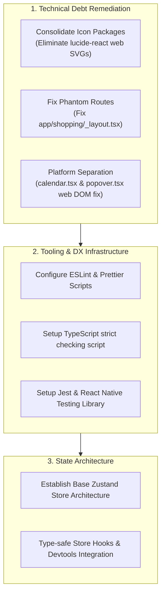

# Milestone 1: Technical Debt Remediation & Cross-Platform Foundation

*Document: `docs/milestone-01-foundation-and-architecture.md`*  
*Status: Ready for Execution*  
*Prerequisites: None*  
*Part of: [Milestones Overview](file:///c:/Users/aaron/Documents/projects/soft-touch/docs/milestones-overview.md)*

---

## 1. Objective & Purpose

Stabilize the application foundation, eliminate critical technical debt identified in [`ai/current-state.md`](file:///c:/Users/aaron/Documents/projects/soft-touch/ai/current-state.md), resolve cross-platform runtime incompatibilities between React DOM and React Native, fix broken navigation routes, and establish automated linting, type-checking, and test tooling.

---

## 2. Key Issues Addressed & Scope

---

## 3. Detailed Technical Tasks & Specifications

### Task 1.1: Icon Library Consolidation
- **Problem**: `app/_layout.tsx` imports icons from two conflicting packages: `lucide-react` (React Web DOM SVGs) and `lucide-react-native`. Rendering web SVGs on native iOS/Android causes runtime crashes or layout errors.
- **Solution**:
  - Remove all imports from `lucide-react` in application screens and components.
  - Standardize all icon usage exclusively on `lucide-react-native` wrapped with `components/ui/icon.tsx` (`iconWithClassName`).
  - Update `app/_layout.tsx` icons:
    - Replace `House`, `SquareLibrary`, `Store`, `Cog` with their `lucide-react-native` counterparts: `Home` (or `House`), `Library`, `ShoppingBag` (or `Store`), `Settings` (or `Cog`).
- **Files Affected**:
  - [`app/_layout.tsx`](file:///c:/Users/aaron/Documents/projects/soft-touch/app/_layout.tsx)
  - [`package.json`](file:///c:/Users/aaron/Documents/projects/soft-touch/package.json)

---

### Task 1.2: Fix Broken Nested Layout in `app/shopping/_layout.tsx`
- **Problem**: `app/shopping/_layout.tsx` was cloned from `app/book/_layout.tsx` and defines three sub-tabs (`index`, `add`, `recommendations`). However, `app/shopping/` only contains `index.tsx`. Clicking phantom tabs causes missing route warnings and broken navigation state.
- **Solution**:
  - Reconfigure `app/shopping/_layout.tsx` to serve as a clean Stack navigator or single-screen layout suitable for the bookstore flow.
  - Define proper bookstore routes:
    - `index`: Bookstore storefront (`app/shopping/index.tsx`)
    - `[id]`: Product detail screen (prepared for Milestone 5)
    - `cart`: Shopping cart screen (prepared for Milestone 5)
- **Files Affected**:
  - [`app/shopping/_layout.tsx`](file:///c:/Users/aaron/Documents/projects/soft-touch/app/shopping/_layout.tsx)

---

### Task 1.3: Web DOM Primitive Abstraction & Platform Parity
- **Problem**:
  - `components/ui/calendar.tsx` contains raw HTML tags (`
`, `<td>`, `react-day-picker`) without native fallbacks.
  - `components/ui/popover.tsx` imports directly from `@radix-ui/react-popover`.
  - These crash when evaluated in iOS and Android native runtimes.
- **Solution**:
  - Separate web and native implementations using platform file extensions (`.web.tsx` and `.tsx` / `.native.tsx`) or `@rn-primitives` native-compatible alternatives.
  - Ensure the cross-platform date picker abstraction in `components/datepicker.tsx` cleanly falls back to `@react-native-community/datetimepicker` on native platforms and web calendar on web.
- **Files Affected**:
  - `components/ui/calendar.web.tsx` / `components/ui/calendar.tsx`
  - `components/ui/popover.web.tsx` / `components/ui/popover.tsx`
  - [`components/datepicker.tsx`](file:///c:/Users/aaron/Documents/projects/soft-touch/components/datepicker.tsx)

---

### Task 1.4: Tooling Setup (ESLint, Type Check & Jest Testing)
- **Problem**: No test scripts, typecheck scripts, or linter configurations exist in `package.json`.
- **Solution**:
  - Add scripts to `package.json`:
    - `"lint": "eslint . --ext .ts,.tsx"`
    - `"typecheck": "tsc --noEmit"`
    - `"test": "jest"`
    - `"test:watch": "jest --watch"`
  - Configure `eslint.config.js` or `.eslintrc.js` with Expo and React Native rules.
  - Install and configure `jest-expo`, `@testing-library/react-native`, and `@testing-library/jest-native`.
  - Add a smoke test (`components/__tests__/book-card.test.tsx`) to verify test pipeline operation.
- **Files Affected**:
  - [`package.json`](file:///c:/Users/aaron/Documents/projects/soft-touch/package.json)
  - `jest.config.js`
  - `jest.setup.js`
  - `components/__tests__/book-card.test.tsx`

---

### Task 1.5: Modern Reactive State Store Scaffolding
- **Problem**: `lib/book-store.ts` uses an ad-hoc mutable array with `useSyncExternalStore`. As features grow (Auth, Cart, Filters, Library), a standardized, testable, and scalable state management pattern is required.
- **Solution**:
  - Install `zustand` (already in `node_modules` or `package.json`) as the unified state container.
  - Refactor `lib/book-store.ts` to use a typed Zustand store with actions and selectors, maintaining backward compatibility with existing components (`useBooks`).
  - Create directory `lib/stores/` to house future feature stores (`auth-store.ts`, `cart-store.ts`, `settings-store.ts`).
- **Files Affected**:
  - [`lib/book-store.ts`](file:///c:/Users/aaron/Documents/projects/soft-touch/lib/book-store.ts)
  - `lib/stores/book-store.ts`

---

## 4. Acceptance Criteria & Invariants

| ID | Category | Condition / Invariant | Verification Method |
| :--- | :--- | :--- | :--- |
| **AC-1.1** | Icon Integrity | Zero runtime errors or warnings regarding `lucide-react` on Android, iOS, or Web. | Launch `npm run web` and verify console clean. |
| **AC-1.2** | Route Integrity | Navigating to `/shopping` renders without warnings; no phantom sub-tabs exist. | Expo router navigation test. |
| **AC-1.3** | Platform Primitives | `DatePickerDemo` opens native date picker on iOS/Android and web calendar on Web without crashing. | Run on web and check mobile simulator/preview. |
| **AC-1.4** | Type Check | `npm run typecheck` passes with 0 errors. | Execute `tsc --noEmit`. |
| **AC-1.5** | Test Pipeline | `npm test` runs and executes at least 1 passing test component. | Run `jest`. |
| **AC-1.6** | Store Parity | Adding a book via `/book/add` continues to reactively update `/book` bookshelf. | Functional manual test. |

---

## 5. Verification Checklist

- [ ] All icon imports in `app/_layout.tsx` use `lucide-react-native`.
- [ ] `app/shopping/_layout.tsx` replaces phantom book tabs with a valid stack or single screen.
- [ ] Platform separation implemented for web-only Radix/DOM components.
- [ ] `package.json` contains `lint`, `typecheck`, and `test` scripts.
- [ ] Smoke test passes successfully via `npm test`.
- [ ] Code formatted according to `.prettierrc`.
- [ ] No git commit executed (per `ai/rule.md`).
