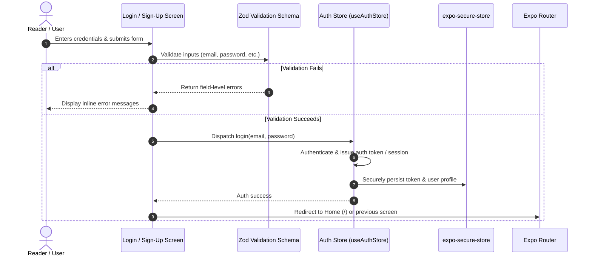

# Milestone 2: Reader Identity, Authentication & Profile

*Document: `docs/milestone-02-identity-auth-and-profile.md`*  
*Status: Planned*  
*Prerequisites: [Milestone 1 — Foundation & Architecture](file:///c:/Users/aaron/Documents/projects/soft-touch/docs/milestone-01-foundation-and-architecture.md)*  
*Part of: [Milestones Overview](file:///c:/Users/aaron/Documents/projects/soft-touch/docs/milestones-overview.md)*  
*Reference Glossary: [`docs/glossary.md`](file:///c:/Users/aaron/Documents/projects/soft-touch/docs/glossary.md#24-user-identity-authentication--profile-subdomain)*

---

## 1. Objective & Purpose

Deliver a complete, secure identity and authentication lifecycle for readers. This includes validating registration and login credentials using Zod, persisting sessions securely using `expo-secure-store`, supporting third-party social connections (Apple, Google, GitHub), establishing authenticated route guards, and building out the User Profile and Settings management screens.

---

## 2. Architecture & Authentication Flow



---

## 3. Domain Models & Schemas

### 3.1 User Profile Contract (`types/auth.ts`)
```typescript
export interface UserProfile {
  id: string;
  email: string;
  firstName: string;
  lastName: string;
  dateOfBirth?: string; // ISO-8601 YYYY-MM-DD
  avatarUri?: string;
  bio?: string;
  createdAt: string; // ISO-8601
  preferences: {
    theme: 'light' | 'dark' | 'system';
    language: 'en' | 'de';
    notificationsEnabled: boolean;
  };
}

export interface AuthSession {
  accessToken: string;
  refreshToken?: string;
  expiresAt: number;
  user: UserProfile;
}
```

### 3.2 Zod Validation Schemas (`lib/validations/auth.ts`)
```typescript
import { z } from 'zod';

export const SignInSchema = z.object({
  email: z.string().email('Please enter a valid email address'),
  password: z.string().min(8, 'Password must be at least 8 characters long'),
});

export const SignUpSchema = z
  .object({
    firstName: z.string().min(1, 'First name is required').max(50),
    lastName: z.string().min(1, 'Last name is required').max(50),
    dateOfBirth: z
      .date()
      .max(new Date(), 'Date of birth cannot be in the future')
      .refine(
        (val) => {
          const age = new Date().getFullYear() - val.getFullYear();
          return age >= 13;
        },
        { message: 'You must be at least 13 years old to register' }
      ),
    email: z.string().email('Please enter a valid email address'),
    password: z
      .string()
      .min(8, 'Password must be at least 8 characters long')
      .regex(/[A-Z]/, 'Password must contain at least one uppercase letter')
      .regex(/[0-9]/, 'Password must contain at least one number'),
    confirmPassword: z.string().min(1, 'Please confirm your password'),
  })
  .refine((data) => data.password === data.confirmPassword, {
    message: 'Passwords do not match',
    path: ['confirmPassword'],
  });

export type SignInInput = z.infer<typeof SignInSchema>;
export type SignUpInput = z.infer<typeof SignUpSchema>;
```

---

## 4. Key Epics & Features

### Epic 2.1: Controlled Forms with Real-Time Validation
- Upgrade `components/sign-in-form.tsx` and `components/sign-up-form.tsx` to controlled forms using `react-hook-form` and `@hookform/resolvers/zod`.
- Show inline error messages under each form field using `components/ui/text.tsx` with variant `destructive`.
- Connect the date picker in `sign-up-form.tsx` properly to form state.
- Add password visibility toggle (Eye / EyeOff icon from `lucide-react-native`).

### Epic 2.2: Auth Store & Secure Token Lifecycle
- Create `lib/stores/auth-store.ts` using Zustand.
- Store token securely:
  - Mobile (iOS/Android): Use `expo-secure-store`.
  - Web: Use secure encrypted `localStorage` or session cookie simulation.
- Implement methods:
  - `signIn(credentials)`
  - `signUp(data)`
  - `signOut()`
  - `restoreSession()` on application startup in `app/_layout.tsx`.
- Track state: `isLoading`, `isAuthenticated`, `currentUser`, `error`.

### Epic 2.3: Social Authentication Integration
- Implement OAuth handlers in `components/social-connections.tsx`:
  - Apple Authentication via `expo-apple-authentication` (iOS native).
  - Google and GitHub OAuth flow scaffolding via `expo-auth-session`.
- Fallback gracefully when OAuth providers are unavailable or cancelled by user.

### Epic 2.4: Reader Profile Management (`app/profilePage.tsx`)
- Display reader profile header:
  - Profile avatar (with option to choose new photo via `expo-image-picker`).
  - Full name (`${firstName} ${lastName}`) and email.
  - Member since date.
  - Quick reading stats counter: Books Read, Currently Reading, Reading Goal.
- Editable user profile fields: First Name, Last Name, Bio.
- Navigation button to Settings.

### Epic 2.5: Settings & Application Preferences (`app/settingsPage.tsx`)
- Appearance selector: Toggle between Light, Dark, or System theme.
- Language selector: English / Deutsch.
- Notification toggles: Reading reminders, New recommendation alerts.
- Account Actions:
  - Clear cache / local data with confirmation alert.
  - Sign Out button with confirmation modal (clears session and redirects to `/(auth)/login`).

---

## 5. Acceptance Criteria (Given-When-Then)

### AC-2.1: Sign-Up Form Validation
- **Given** a user is on the registration screen (`/sign-up`)
- **When** the user submits an invalid email, a birthdate in the future, or mismatched passwords
- **Then** error messages appear under each corresponding field and submission is blocked.

### AC-2.2: Successful Registration & Session Persistence
- **Given** valid registration details are entered
- **When** the user taps "Create Account"
- **Then** the account is created, a session token is securely stored in `expo-secure-store`, the user is logged in, and navigated to the Home screen (`/`).

### AC-2.3: Session Restoration on App Launch
- **Given** an authenticated user closes and relaunches the application
- **When** the app initializes in `app/_layout.tsx`
- **Then** `restoreSession()` retrieves the stored token and restores user state without requiring re-login.

### AC-2.4: Sign Out Lifecycle
- **Given** an authenticated user is on the Settings or Profile screen
- **When** the user taps "Log Out" and confirms
- **Then** the session token is removed from secure storage, the store resets to unauthenticated, and the app redirects to `/(auth)/login`.

---

## 6. Verification Checklist

- [ ] `zod` and `react-hook-form` installed and wired to sign-in and sign-up forms.
- [ ] Unit tests for `SignInSchema` and `SignUpSchema` covering edge cases.
- [ ] `auth-store.ts` implemented with unit tests verifying login, logout, and token restore.
- [ ] Profile page displays active user information and allows editing.
- [ ] Settings page allows theme switching and signs out user cleanly.
- [ ] No git commit executed (per `ai/rule.md`).
