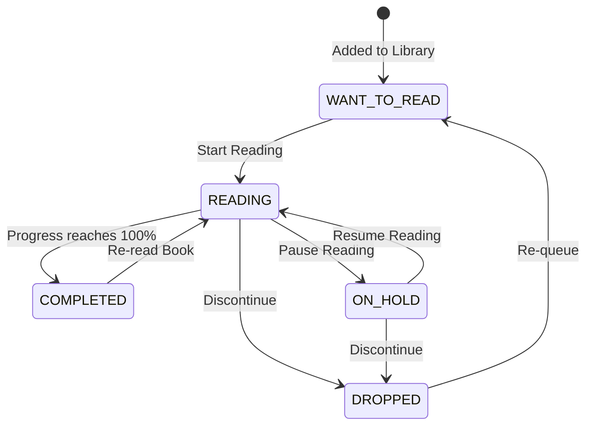

# Milestone 3: Personal Library & Reading Lifecycle

*Document: `docs/milestone-03-personal-library-and-reading.md`*  
*Status: Planned*  
*Prerequisites: [Milestone 1 — Foundation & Architecture](file:///c:/Users/aaron/Documents/projects/soft-touch/docs/milestone-01-foundation-and-architecture.md)*  
*Part of: [Milestones Overview](file:///c:/Users/aaron/Documents/projects/soft-touch/docs/milestones-overview.md)*  
*Reference Glossary: [`docs/glossary.md`](file:///c:/Users/aaron/Documents/projects/soft-touch/docs/glossary.md#21-reader--personal-library-subdomain)*

---

## 1. Objective & Purpose

Build out the core Personal Library and reading tracking capabilities of Soft-Touch. Readers can organize their books into curated shelves, track reading statuses and page progress, log personal reflections and ratings, and view their reading statistics on a comprehensive Book Detail screen and Home dashboard.

---

## 2. Reading Status Lifecycle & Architecture



---

## 3. Domain Models & Schemas

### 3.1 Extended Book & Library Entry Contract (`types/library.ts`)
```typescript
export type ReadingStatus = 
  | 'WANT_TO_READ' 
  | 'READING' 
  | 'COMPLETED' 
  | 'ON_HOLD' 
  | 'DROPPED';

export interface BookMetadata {
  id: string;
  isbn: string;
  title: string;
  author: string;
  coverUri?: string;
  description?: string;
  publisher?: string;
  publishedYear?: number;
  pageCount: number;
  genre?: string[];
  language?: string;
}

export interface LibraryBookItem extends BookMetadata {
  userId: string;
  readingStatus: ReadingStatus;
  currentPage: number;
  progressPercent: number; // 0 to 100
  rating?: number; // 1 to 5 stars
  personalNotes?: string;
  dateAdded: string; // ISO-8601
  dateStarted?: string; // ISO-8601
  dateCompleted?: string; // ISO-8601
  favorite?: boolean;
}
```

### 3.2 Invariants
1. **Progress Bound**: `0 <= currentPage <= pageCount`.
2. **Completion Trigger**: When `currentPage === pageCount`, status automatically transitions to `COMPLETED` unless manually overridden.
3. **Rating Bounds**: If specified, `rating` must be an integer between `1` and `5`.

---

## 4. Key Epics & Features

### Epic 3.1: Enhanced Bookshelf View (`app/book/index.tsx`)
- **Status Filter Segment**:
  - Horizontal filter tabs: `All`, `Currently Reading`, `Want to Read`, `Completed`, `Favorites`.
  - Badge counts indicating total books in each status category.
- **Search & Sort Controls**:
  - Instant live filter bar searching by Title, Author, or ISBN.
  - Sort dropdown: Date Added (newest/oldest), Title (A-Z), Author (A-Z), Rating.
- **View Mode Switcher**:
  - Toggle between **Card Grid** (2-column cover display) and **Detailed List** view.
- **Empty States**:
  - Welcoming illustrations and prompt buttons: *"Your bookshelf is empty. Add your first book!"* navigating to `/book/add`.

### Epic 3.2: Comprehensive Book Detail Screen (`app/book/[id].tsx`)
- Dynamic route `app/book/[id].tsx` accessible by tapping any book card.
- **Header Section**:
  - High-resolution cover art (or fallback banner if no cover provided).
  - Title, author, publisher, publication year, and genre tags.
  - Favorite toggle (Heart icon).
- **Reading Status & Progress Control**:
  - Status selector picker (`Reading`, `Completed`, etc.).
  - Interactive page progress slider and direct numeric input (`e.g., 145 / 320 pages`).
  - Visual animated progress bar reflecting completion percentage.
- **Reader Reflections & Review**:
  - Star rating selector (1 to 5 stars).
  - Personal notes text area with autosave.
  - Date started and date finished tracking.
- **Danger Zone / Management**:
  - Option to remove book from library with confirmation prompt.

### Epic 3.3: Home Dashboard Reading Highlights (`app/index.tsx`)
- **Reading Streak & Goal Widget**:
  - "Currently Reading" carousel highlighting active books with quick "Update Progress" button.
  - Annual reading challenge tracker (e.g., "12 of 25 books read in 2026").
- **Recent Additions**:
  - Quick horizontally scrolling list of the most recently added library books.

### Epic 3.4: Library State Store (`lib/stores/library-store.ts`)
- Zustand store managing:
  - `books: LibraryBookItem[]`
  - `activeFilter: ReadingStatus | 'ALL'`
  - `searchQuery: string`
  - Actions: `updateReadingProgress(id, page)`, `setReadingStatus(id, status)`, `setRating(id, rating)`, `updateNotes(id, text)`, `removeBook(id)`, `toggleFavorite(id)`.

---

## 5. Acceptance Criteria (Given-When-Then)

### AC-3.1: Reading Progress Invariant
- **Given** a book with 300 total pages has current progress of 150 pages
- **When** the user inputs 300 pages and saves
- **Then** `progressPercent` updates to 100% and `readingStatus` automatically transitions to `COMPLETED` with `dateCompleted` set to the current date.

### AC-3.2: Filter and Search Precision
- **Given** a library containing 10 books across different statuses
- **When** the user selects the "Currently Reading" tab and enters "Kafka" into the search bar
- **Then** only books matching author "Kafka" with status `READING` are visible in the list.

### AC-3.3: Book Removal
- **Given** an existing book in the personal library
- **When** the user taps "Remove from Library" on the detail screen and confirms the alert
- **Then** the book is removed from the store, and the user is navigated back to the Bookshelf with a confirmation toast.

---

## 6. Verification Checklist

- [ ] Route `app/book/[id].tsx` created and wired to book cards.
- [ ] Status filters and search bar functional with instant reactivity.
- [ ] Reading progress slider clamps values between 0 and `pageCount`.
- [ ] Star rating component allows setting and clearing ratings (1-5).
- [ ] Unit tests for `library-store.ts` covering progress calculation, status transitions, and deletion.
- [ ] Home screen reflects active reads and progress bars.
- [ ] No git commit executed (per `ai/rule.md`).
