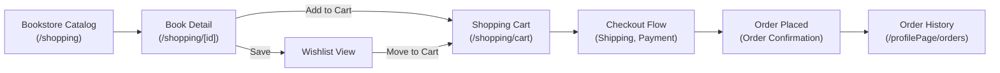

# Milestone 5: Bookstore & Commerce

*Document: `docs/milestone-05-bookstore-and-commerce.md`*  
*Status: Planned*  
*Prerequisites: [Milestone 2 — Identity, Auth & Profile](file:///c:/Users/aaron/Documents/projects/soft-touch/docs/milestone-02-identity-auth-and-profile.md)*  
*Part of: [Milestones Overview](file:///c:/Users/aaron/Documents/projects/soft-touch/docs/milestones-overview.md)*  
*Reference Glossary: [`docs/glossary.md`](file:///c:/Users/aaron/Documents/projects/soft-touch/docs/glossary.md#23-bookstore--commerce-subdomain)*

---

## 1. Objective & Purpose

Transform the placeholder Bookstore screen (`/shopping`) into an engaging, full-featured commercial bookstore. Enable readers to browse commercial book offerings, inspect book editions, manage a shopping cart and wishlist, simulate checkout with shipping and payment, and view past order confirmations.

---

## 2. Commerce Journey & Architecture



---

## 3. Domain Models & Contracts (`types/commerce.ts`)

```typescript
export type BookFormat = 'HARDCOVER' | 'PAPERBACK' | 'EBOOK';
export type StockStatus = 'IN_STOCK' | 'LOW_STOCK' | 'OUT_OF_STOCK';

export interface CommerceListing {
  id: string;
  isbn: string;
  title: string;
  author: string;
  coverUri: string;
  description: string;
  price: number; // in cents or decimal euros (e.g. 14.99)
  currency: string; // 'EUR' | 'USD'
  formats: {
    format: BookFormat;
    price: number;
    stock: StockStatus;
  }[];
  rating: number; // average rating e.g. 4.8
  reviewCount: number;
  featured?: boolean;
  bestseller?: boolean;
}

export interface CartItem {
  listingId: string;
  isbn: string;
  title: string;
  author: string;
  coverUri: string;
  selectedFormat: BookFormat;
  unitPrice: number;
  quantity: number;
}

export interface ShippingAddress {
  fullName: string;
  streetAddress: string;
  apartmentSuite?: string;
  city: string;
  postalCode: string;
  country: string;
}

export interface Order {
  orderId: string;
  userId: string;
  items: CartItem[];
  subtotal: number;
  shippingFee: number;
  tax: number;
  total: number;
  shippingAddress: ShippingAddress;
  status: 'PENDING' | 'CONFIRMED' | 'SHIPPED' | 'DELIVERED';
  createdAt: string; // ISO-8601
}
```

---

## 4. Key Epics & Features

### Epic 5.1: Bookstore Storefront (`app/shopping/index.tsx`)
- **Hero Banners**: Promotional banners featuring books of the month and seasonal author spotlights.
- **Categorized Sections**:
  - *Bestsellers & New Releases* (horizontal scroll cards).
  - *Literary Classics & Contemporary Fiction*.
  - *Philosophical Essays & Non-Fiction*.
- **Search & Filters**:
  - Search by title, author, keyword.
  - Filter modal: Format (Hardcover/Paperback/eBook), Price Range, Genre, In-Stock Only.
- **Cart Badge Indicator**: Persistent shopping bag icon in header showing current total item count.

### Epic 5.2: Product Details Screen (`app/shopping/[id].tsx`)
- Rich product page with:
  - High-res cover gallery and book metadata.
  - Format selection chips (`Hardcover: €24.00`, `Paperback: €14.99`, `eBook: €9.99`).
  - Stock availability pill (`In Stock — Ready to ship`).
  - Synopsis with expandable "Read more" toggle.
  - Excerpt preview drawer: Sample reader view to preview the first chapter.
  - Action row: "Add to Cart" button & "Add to Wishlist" heart button.

### Epic 5.3: Wishlist Management
- Create Wishlist screen or tab section:
  - Displays saved commercial titles.
  - One-click "Move to Cart" button.
  - Remove from wishlist action.

### Epic 5.4: Shopping Cart Screen (`app/shopping/cart.tsx`)
- Dynamic cart state management via `useCartStore`:
  - List of cart items with cover, title, selected format, and unit price.
  - Quantity controls (`-` / `+` stepper, minimum 1, delete button).
  - Order Summary Breakdown:
    - Subtotal
    - Estimated Shipping (free over €30.00)
    - Estimated VAT / Tax (included)
    - Total Order Amount
  - Promo code entry with validation feedback.
  - Sticky "Proceed to Checkout" primary button.

### Epic 5.5: Multi-Step Checkout Flow (`app/shopping/checkout.tsx`)
- **Step 1: Shipping Address**:
  - Name, address line, city, postal code, country with Zod validation.
- **Step 2: Shipping Method**:
  - Standard Delivery (3-5 days, €3.99) vs Express (1-2 days, €6.99).
- **Step 3: Payment Simulation**:
  - Mock Apple Pay / Google Pay single-tap button.
  - Credit Card input form with Luhn algorithm validation.
- **Step 4: Order Confirmation**:
  - Order summary confirmation dialog.
  - Generates unique order number (e.g., `ORD-2026-98421`).
  - Clears shopping cart and writes order to user order history.

---

## 5. Acceptance Criteria (Given-When-Then)

### AC-5.1: Cart Price Invariant
- **Given** a shopping cart with 2 paperback books at €14.99 each and standard shipping at €3.99
- **When** the cart calculates totals
- **Then** `subtotal` equals €29.98, shipping equals €3.99, and `total` equals €33.97.

### AC-5.2: Cart Quantity Adjustment
- **Given** an item exists in the cart with quantity 1
- **When** the user taps the `-` button
- **Then** a confirmation prompt appears to remove the item; upon confirmation, the item is removed from the cart.

### AC-5.3: Order Checkout Completion
- **Given** valid shipping details and payment selection
- **When** the user taps "Place Order"
- **Then** the cart is cleared, an Order record is appended to order history, and the user is shown the Order Confirmation screen with order ID and delivery estimate.

---

## 6. Verification Checklist

- [ ] Route `app/shopping/[id].tsx` displays product metadata, formats, and pricing.
- [ ] Cart store (`cart-store.ts`) handles addition, quantity mutation, and clearing.
- [ ] Wishlist store allows toggling items and moving to cart.
- [ ] Cart calculations enforce subtotal and shipping invariants.
- [ ] Checkout form validates address fields and prevents submission of empty addresses.
- [ ] Order confirmation screen properly navigates back to shopping or order history.
- [ ] No git commit executed (per `ai/rule.md`).
