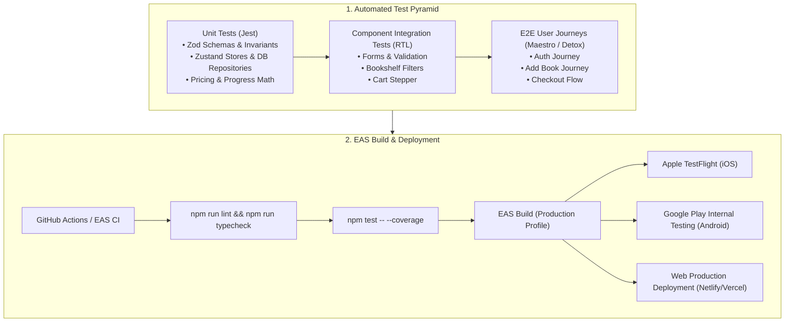

# Milestone 7: Testing, QA Automation & Production Release

*Document: `docs/milestone-07-testing-qa-and-production-release.md`*  
*Status: Planned*  
*Prerequisites: [Milestone 1](file:///c:/Users/aaron/Documents/projects/soft-touch/docs/milestone-01-foundation-and-architecture.md) through [Milestone 6](file:///c:/Users/aaron/Documents/projects/soft-touch/docs/milestone-06-offline-persistence-and-i18n.md)*  
*Part of: [Milestones Overview](file:///c:/Users/aaron/Documents/projects/soft-touch/docs/milestones-overview.md)*

---

## 1. Objective & Purpose

Prepare Soft-Touch for public production release on the Apple App Store, Google Play Store, and Web. Establish a comprehensive automated test pyramid (>85% unit and component test coverage, E2E regression tests), optimize rendering performance and image caching, configure Sentry crash reporting, and set up Expo Application Services (EAS) CI/CD build pipelines.

---

## 2. Quality Assurance & Release Architecture

---

## 3. Key Epics & Features

### Epic 7.1: Comprehensive Test Suite & Automation
- **Unit & Logic Testing (Jest)**:
  - Validation schemas: `SignInSchema`, `SignUpSchema`, `AddBookSchema`, `CheckoutSchema`.
  - Invariant rules: Reading progress percentage, completion triggers, cart pricing calculations, ISBN check-digit verification.
  - SQLite database repositories: CRUD operations, migrations, and foreign key cascades.
  - Coverage threshold enforced: `>= 85%` statement and branch coverage on `lib/` and `types/`.
- **Component Testing (React Native Testing Library)**:
  - `BookCard`: Render cover art, author, title, fallback state when cover is missing.
  - `SignInForm` & `SignUpForm`: Form errors on invalid input, disabled submit state while loading.
  - `BookDetail`: Status picker selection, reading progress slider changes.
- **End-to-End (E2E) Automation (Maestro)**:
  - Auth Flow: Register new user -> Land on Home -> View Profile -> Sign Out.
  - Library Flow: Scan / add book manually -> Verify book appears on Bookshelf -> Update progress to 100% -> Verify moved to Completed shelf.
  - Commerce Flow: Browse Bookstore -> Add book to cart -> Open cart -> Proceed through checkout -> View order confirmation.

### Epic 7.2: Rendering Performance & Media Optimization
- **List Optimization**:
  - Replace standard `ScrollView` / `FlatList` with `@shopify/flash-list` for large bookshelves and bookstore catalogs (>5,000 items).
  - Enforce `estimatedItemSize` and memoized cell renderers (`React.memo`).
- **Image Pipeline**:
  - Replace React Native `Image` with `expo-image`.
  - Enable automatic disk/memory caching, smooth fade transitions, and progressive Blurhash placeholders.
- **Bundle Optimization**:
  - Audit JavaScript bundle using `react-native-bundle-visualizer`.
  - Eliminate duplicate libraries and ensure tree-shaking of unused icons.

### Epic 7.3: Telemetry, Error Boundaries & Crash Reporting
- Implement global React Native `ErrorBoundary` with intuitive recovery UI ("Something went wrong, tap to reload").
- Integrate Sentry for React Native (`@sentry/react-native`):
  - Crash reporting and unhandled promise rejection tracking.
  - Release versioning and source map uploading.
  - Privacy compliance: Strip PII (email, passwords, addresses) from telemetry breadcrumbs.

### Epic 7.4: App Store Packaging & EAS Build Pipeline
- **Expo Application Services (`eas.json`) Configuration**:
  - Development build profile (`development`).
  - Preview build profile for internal QA testing (`preview`).
  - Production build profile for App Store / Play Store (`production`).
- **Store Assets & App Metadata**:
  - High-resolution App Icon (`1024x1024 PNG`, no transparency).
  - Adaptive App Icon for Android (foreground + background monochrome).
  - Splash screen assets with theme-aware background colors (`#ffffff` / `#09090b`).
  - App Store screenshots across 6.7" iPhone, 12.9" iPad, and Android phones.
  - Privacy policy and App Store review notes.

---

## 4. Acceptance Criteria (Given-When-Then)

### AC-7.1: Test Suite Enforcement
- **Given** the CI pipeline runs `npm test -- --coverage`
- **When** test coverage is evaluated across domain and state modules
- **Then** total line and branch coverage exceeds 85% with zero test failures.

### AC-7.2: List Rendering Benchmark
- **Given** a bookshelf populated with 1,000 book items
- **When** rapid vertical scrolling is performed on a low-to-mid-range mobile device
- **Then** UI frame rate maintains a steady 60 FPS without memory leaks or visible jank.

### AC-7.3: Production Build Generation
- **Given** the repository state is verified and clean
- **When** `eas build --platform all --profile production` is executed
- **Then** signed `.ipa` (iOS) and `.aab` (Android) distribution binaries are produced without compilation errors.

---

## 5. Pre-Release Verification Runbook

Before triggering the General Availability (GA) release, execute the following sign-off checklist:

- [ ] All unit, integration, and E2E tests pass cleanly (`npm test`, `maestro test`).
- [ ] TypeScript strict check passes with 0 diagnostics (`npm run typecheck`).
- [ ] Linter reports 0 errors and 0 warnings (`npm run lint`).
- [ ] Light mode and Dark mode visual review on iOS, Android, and Web.
- [ ] Offline capability verified: app functions seamlessly without network connection.
- [ ] App permissions (Camera for barcode scanner) contain clear explanatory disclosure strings.
- [ ] Release notes and changelog authored.
- [ ] No git commit executed (per `ai/rule.md`).
