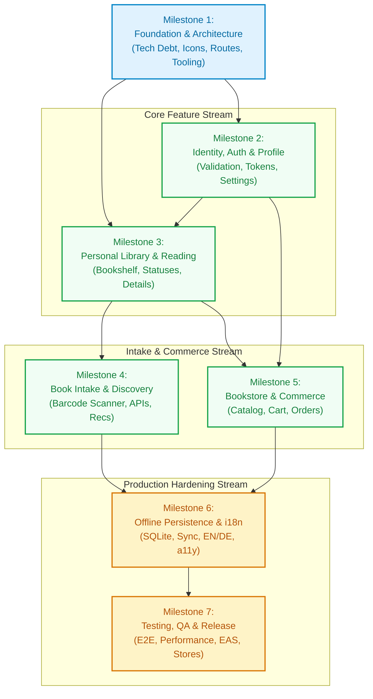
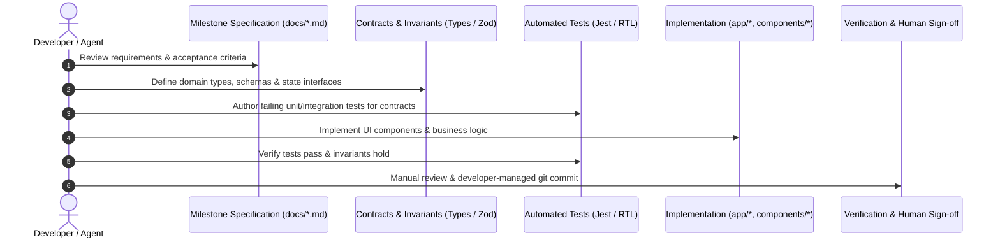

# Soft-Touch — Master Milestones Roadmap

*Document: `docs/milestones-overview.md`*  
*Approach: Spec-Driven Development (SDD) & Domain-Driven Design (DDD)*  
*Target Release: 1.0.0 General Availability (GA)*  
*Reference Glossary: [`docs/glossary.md`](file:///c:/Users/aaron/Documents/projects/soft-touch/docs/glossary.md)*  
*Current State Audit: [`ai/current-state.md`](file:///c:/Users/aaron/Documents/projects/soft-touch/ai/current-state.md)*

---

## 1. Executive Vision & Scope

**Soft-Touch** is a modern, cross-platform (iOS, Android, Web) digital companion designed for readers and book lovers. The application blends:
1. **Personal Library & Bookshelf Curation**: Organize, track, rate, and annotate physical and digital books.
2. **Book Intake & Automated Metadata Discovery**: Barcode scanning, ISBN lookup, and online bibliographic imports.
3. **Reader Identity & Profile**: Personalized reading goals, statistics, streaks, and preferences.
4. **Bookstore & Commerce**: Commercial book discovery, curated recommendations, wishlist, shopping cart, and checkout.

To evolve the application from its current prototype state into a robust, secure, and production-ready mobile and web application, work is structured across **seven discrete milestones**.

---

## 2. Milestone Summary Matrix

| Milestone | Title | Focus Area | Status | Target Deliverables |
| :--- | :--- | :--- | :--- | :--- |
| [**M1**](file:///c:/Users/aaron/Documents/projects/soft-touch/docs/milestone-01-foundation-and-architecture.md) | **Foundation & Architecture** | Tech debt remediation, icon convergence, routing fix, testing harness, state foundations | 🔄 Ready for Execution | Stable cross-platform core, Jest/ESLint setup, unified icons, clean layouts |
| [**M2**](file:///c:/Users/aaron/Documents/projects/soft-touch/docs/milestone-02-identity-auth-and-profile.md) | **Identity, Auth & Profile** | User onboarding, Zod form validation, OAuth, session lifecycle, profile & settings | 📋 Planned | Authenticated session management, secure storage, validated forms, user profile |
| [**M3**](file:///c:/Users/aaron/Documents/projects/soft-touch/docs/milestone-03-personal-library-and-reading.md) | **Personal Library & Reading Lifecycle** | Bookshelf views, reading statuses, progress tracking, book detail views, notes & ratings | 📋 Planned | Multi-shelf views, reading progress log, comprehensive book detail page |
| [**M4**](file:///c:/Users/aaron/Documents/projects/soft-touch/docs/milestone-04-book-intake-and-discovery.md) | **Book Intake & Catalog Discovery** | Camera ISBN barcode scanner, OpenLibrary/Google Books API, manual add, recommendations | 📋 Planned | Zero-friction book scanning, auto-filling metadata, recommendation engine |
| [**M5**](file:///c:/Users/aaron/Documents/projects/soft-touch/docs/milestone-05-bookstore-and-commerce.md) | **Bookstore & Commerce** | Bookstore catalog, search, wishlist, shopping cart, mock checkout, order history | 📋 Planned | End-to-end commerce experience, cart state, order management |
| [**M6**](file:///c:/Users/aaron/Documents/projects/soft-touch/docs/milestone-06-offline-persistence-and-i18n.md) | **Offline Persistence & i18n** | Local SQLite storage, background sync, bilingual English/German i18n, accessibility | 📋 Planned | 100% offline capability, zero data loss, full bilingual support |
| [**M7**](file:///c:/Users/aaron/Documents/projects/soft-touch/docs/milestone-07-testing-qa-and-production-release.md) | **Testing, QA & Production Release** | Test coverage (>85%), E2E automation, performance optimization, EAS build & App Stores | 📋 Planned | Production store builds (IPA/AAB), automated CI/CD pipeline, crash monitoring |

---

## 3. Milestone Dependency & Execution Roadmap

---

## 4. Spec-Driven Development (SDD) Workflow per Milestone

Every milestone follows a strict SDD lifecycle to prevent regressions and maintain continuous architectural integrity:

### Invariant Rules for Implementation:
1. **No Automated Commits**: In compliance with [`ai/rule.md`](file:///c:/Users/aaron/Documents/projects/soft-touch/ai/rule.md), all git commits are staged and reviewed by the human developer.
2. **Canonical Ubiquitous Language**: Terminology across all code, identifiers, types, and database tables must strictly align with [`docs/glossary.md`](file:///c:/Users/aaron/Documents/projects/soft-touch/docs/glossary.md).
3. **Cross-Platform Parity**: Features must run properly across iOS, Android, and Web without runtime crashes caused by platform-incompatible web DOM or native-only APIs.

---

## 5. Milestone Index & Navigation

Detailed documentation for each individual milestone can be accessed via the links below:

- 📄 [**Milestone 1 — Technical Debt Remediation & Cross-Platform Foundation**](file:///c:/Users/aaron/Documents/projects/soft-touch/docs/milestone-01-foundation-and-architecture.md)
- 📄 [**Milestone 2 — Reader Identity, Authentication & Profile**](file:///c:/Users/aaron/Documents/projects/soft-touch/docs/milestone-02-identity-auth-and-profile.md)
- 📄 [**Milestone 3 — Personal Library & Reading Lifecycle**](file:///c:/Users/aaron/Documents/projects/soft-touch/docs/milestone-03-personal-library-and-reading.md)
- 📄 [**Milestone 4 — Book Intake & Catalog Discovery**](file:///c:/Users/aaron/Documents/projects/soft-touch/docs/milestone-04-book-intake-and-discovery.md)
- 📄 [**Milestone 5 — Bookstore & Commerce**](file:///c:/Users/aaron/Documents/projects/soft-touch/docs/milestone-05-bookstore-and-commerce.md)
- 📄 [**Milestone 6 — Offline Persistence, State Sync & Internationalization**](file:///c:/Users/aaron/Documents/projects/soft-touch/docs/milestone-06-offline-persistence-and-i18n.md)
- 📄 [**Milestone 7 — Testing, QA Automation & Production Release**](file:///c:/Users/aaron/Documents/projects/soft-touch/docs/milestone-07-testing-qa-and-production-release.md)
